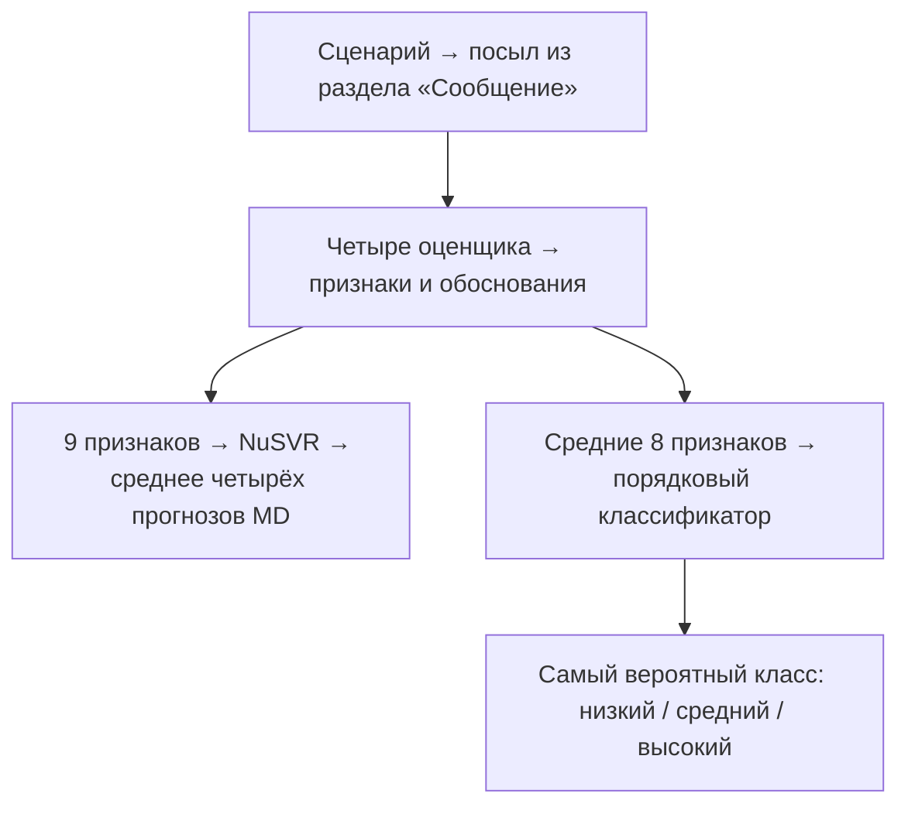

# AIPM 3.1 · Оценка рекламных сценариев

Приложение оценивает считываемость основного предложения рекламы — **Message Delivery (MD)** — по описанному сценарию. Принимает DOCX, PDF с таблицей сцен и разделом «Сообщение», а также JSON-карточки.

**Текущий релиз от 18 ноября 2026 года:** `scenario-nusvr9-joint-ordinal8-four-20261118-v1`.

- **Числовой скор MD:** замороженная NuSVR по **девяти** признакам, включая время раскрытия роли продукта.
- **Класс:** отдельный порядковый классификатор по **восьми** признакам, обученный одновременно на классах видео и человеческого MD с равными весами **50/50**.
- Выбирается **самый вероятный класс** (`posterior_mode`), без дополнительной температурной калибровки, смещения вероятностей или повышения высокого класса.
- Оценщики: Gemini 3.1 Pro, Claude Sonnet 4.6, GPT-5.4 и Claude Opus 4.6.

## Как устроен расчёт



1. Сохраняются тайминги сцен, изображение, реплики, экранный текст и контекст звука и креативных приёмов. Gemini формулирует посыл из раздела «Сообщение».
2. Четыре оценщика независимо измеряют признаки. Для показа ключевой функции каждый получает полный зафиксированный посыл и только визуальные описания сцен. Количество выгод рассчитывается как `min(4, число подтверждённых самостоятельных групп выгод)`.
3. Конкуренция посылов усредняется по четырём оценщикам перед подачей в модель. Остальные восемь входов NuSVR сохраняются индивидуальными. **Скор сценария — среднее четырёх прогнозов**, а не прогноз по среднему вектору всех признаков.
4. Для класса берутся средние оценки первых восьми признаков. Порядковый классификатор возвращает вероятности трёх классов, выбирается максимальная. Дополнительной калибровки вероятностей нет.
5. Приложение показывает посыл, скор, класс, оценки признаков и их вклад в числовой MD относительно медианного базового сценария. Вклад относится к NuSVR-скору и не является объяснением отдельного класса или причинным эффектом изменения сценария.
6. Сводное объяснение объединяет сохранённые обоснования оценщиков и цитаты. Оно не изменяет скор или класс. При недоступности сводки показываются сохранённые индивидуальные обоснования.

## Входы моделей

| Признак | Шкала | NuSVR MD | Видеопризнак | Спирмен | Пар |
|---|---|---|---|---:|---:|
| Главный персонаж | 0/1 | Да | Главный персонаж | 0,780 | 56 |
| Числовое предложение на экране | 0/1 | Да | Числовое предложение на экране¹ | 0,746 | 55 |
| Количество самостоятельных выгод | 0–4 | Да | Количество выгод | 0,815 | 56 |
| Необходимость объяснения новизны | 0–3 | Да | Необходимость объяснения новизны | 0,788 | 56 |
| Промо | 0/1 | Да | Промо | 0,898 | 56 |
| Точность содержания основного утверждения | 0–4 | Да | Точность содержания | 0,602 | 56 |
| Конкуренция посылов | Число дополнительных самостоятельных посылов | Да | Количество дополнительных утверждений¹ ² | 0,612 | 56 |
| Показ ключевой функции сервиса/продукта | 0–2 | Да | Связь изображения и речи² | 0,505 | 56 |
| **Время раскрытия роли продукта** | **0–4** | Да | Время раскрытия роли продукта | 0,755 | 56 |

Спирмен рассчитан на общих парах «сценарий — готовое видео»: для сценария усреднены сохранённые оценки четырёх оценщиков, для видео — сохранённые измерения. Для числового предложения доступны 55 пар из-за одного пропуска; остальные строки рассчитаны на 56 парах.

¹ Числовое предложение и дополнительные утверждения взяты из сохранённых измерений тех же видео; в текущие входы видеомодели они не входят.

² Для конкуренции посылов и показа ключевой функции сопоставлены близкие по смыслу видеопризнаки с разными инструкциями оценки.

Время раскрытия роли продукта: **0** — до 5 с; **1** — от 5 до менее 10 с; **2** — от 10 до 15 с включительно; **3** — позже 15 с; **4** — роль не объяснена. Первое название или логотип сами по себе не обязательно раскрывают роль. Если точный момент не задан, используется начало первой сцены, где роль явно объяснена, с сохранением интервала в обосновании.

Для этого входа сохранён контракт из исследования: отдельный запрос каждого оценщика измеряет время раскрытия роли вместе со связью изображения и речи и недостающей смысловой цепочкой. **Последние два поля сохраняются для аудита, но не подаются ни в NuSVR, ни в классификатор.** Недостающая оценка времени не заменяется нулём.

Голос, музыка, звуковой дизайн и креативные приёмы остаются контекстом. Авторское пояснение намерения не заменяет конкретное действие в сцене. Точные инструкции находятся в `protocols/stages.json`, `artifacts/function_demo.json` и `artifacts/role_inputs.json`.

## Модели и воспроизводимость

**NuSVR:** RBF, `C=1`, `gamma=0.045`, `nu=0.5`, логарифмическая целевая переменная — человеческий MD. Подготовка: сохранённые медианы, средние и масштабы, округление стандартизованных входов шагом 0,5. После обратного преобразования применяется зафиксированная аффинная калибровка **числового скора**, рассчитанная на обучающей части. Это не дополнительная калибровка вероятностей классов.

Модель обучалась на 58 сценариях из 56 семейств с равным суммарным весом каждого семейства. В приложении используется переносимый JSON с опорными векторами и коэффициентами; `scikit-learn` для расчёта не требуется. Обучения при загрузке сценария нет.

**Порядковый классификатор:** восемь средних признаков, совместная цель «видеокласс + человеческий класс» с весами 50/50 и равными суммарными весами семейств. Обучение — 56 пар / 54 семейства. Регуляризация выбрана внутри групповой проверки. Три вероятности рассчитываются сохранённой порядковой моделью; итог — `argmax`, а не медиана распределения. Человеческие метки при обучении определены по MD 20%/26%, видеометки — по замороженным границам видео 19,553%/28,612%. Эти границы не применяются к скору сценария для выдачи итогового класса.

Модель с временем раскрытия роли продукта в классификаторе, дополнительные калибровки вероятностей, приоритет высокого класса, бустинг и выравнивание весов классов в этот релиз не включены.

## Результаты проверки

Сравнение выполнено на одних **56 парах / 54 семействах**, для которых доступны новые видеорезультаты. NuSVR обучалась с 56 исключениями семейств на исходных 58 сценариях; итоговые корреляции ниже рассчитаны только на общих 56 парах.

| OOF-корреляция скора NuSVR, Спирмен | Значение |
|---|---:|
| С видеоскором MD нового пакета от 17 ноября 2026 | **0,780** |
| С человеческим MD | **0,528** |
| MAE к человеческому MD на общих парах | **5,945 п.п.** |

Классификатор проверен с исключением семейства; регуляризация выбиралась внутри обучающих семейств по пяти групповым блокам.

| OOF-совпадения классов | С видео | С человеческим MD |
|---|---:|---:|
| Низкий | 7/11 | 6/14 |
| Средний | 25/28 | 19/24 |
| Высокий | 10/17 | 8/18 |
| **Всего** | **42/56 — 75,0%** | **33/56 — 58,9%** |

Выборка неоднократно использовалась в исследованиях моделей и признаков; независимой проверки на новых сценариях пока нет. Скор не является результатом опроса зрителей или гарантией восприятия будущего ролика.

## Запуск

```bash
python -m pip install -r requirements.txt
streamlit run app.py
```

Ключ задаётся как `VSELLM_API_KEY` в окружении, Streamlit Secrets или поле подключения. Адрес API при необходимости задаётся через `VSELLM_BASE_URL`. Ключ не записывается в результат или кэш.

На холодном кэше требуется **21 успешный запрос** для расчёта: один для формулировки посыла и пять этапов от каждого из четырёх оценщиков. Ещё один запрос формирует сводное объяснение — **22 со сводкой**, без учёта повторных попыток. `SCENARIO_SUMMARY_MODEL` меняет только модель сводного объяснения.

Новые запросы разрешаются кнопкой **«Оценить сценарии»**. Кнопка **«Рассчитать из сохранённых ответов»** работает только с кэшем и сообщает о недостающих этапах. Успешные прежние этапы переиспользуются; для NuSVR нужны дополнительные четыре сохранённых оценки времени раскрытия роли.

CLI:

```bash
# По умолчанию только кэш; --live разрешает новые AI-запросы.
python -m scenario_model evaluate examples/scenario.json --output result.json --live
python -m scenario_model replay result.json
```

Прежние результаты Ridge открываются и воспроизводятся по своему прежнему протоколу. Они не превращаются автоматически в NuSVR-результаты. Старые артефакты и их манифест сохранены; новый релиз имеет отдельные модель, классификатор, контракт и SHA-256-манифест.

## Структура и проверки

```text
app.py                          # Streamlit
scenario_model/                 # протокол, NuSVR, класс, объяснения, CLI, replay
artifacts/nusvr9.json            # числовой скор, 9 входов
artifacts/joint_ordinal8.json     # совместный порядковый класс, 8 входов
artifacts/role_inputs.json       # зафиксированный дополнительный этап
artifacts/nusvr_manifest.json    # SHA-256 текущего релиза
artifacts/release_metrics.json   # OOF-метрики и ограничения
tests/fixtures/nusvr_ordinal.json # синтетические примеры паритета
docs/legacy-20261111.md          # описание прежнего релиза
```

```bash
python -m unittest discover -s tests -v
```

Проверки покрывают переносимый расчёт NuSVR и вероятностей класса, выбор самого вероятного класса, отдельные 9/8 входов, полный кэш и replay, защиту от подмены сохранённых данных, воспроизведение прежних результатов и отображение в Streamlit. Тестовые эталоны синтетические; реальные сценарии и человеческие оценки в репозиторий не включены.

Для воспроизводимого экспорта уже обученных исследовательских артефактов: `python tools/export_nusvr_ordinal.py --research-root /path/to/research`. Этот служебный экспорт требует `scikit-learn`, `scipy` и `joblib`; приложение не обучает модели.
