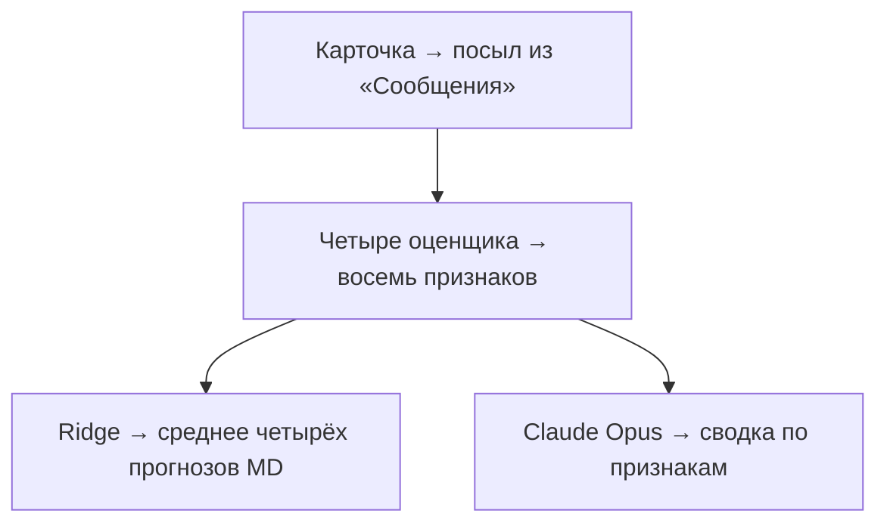

# AIPM 3.1 · Оценка рекламных сценариев

Модель прогнозирует, насколько легко зрителю будет понять идею будущей рекламы: что предлагает компания и какую пользу получает пользователь. Она помогает сравнивать сценарии до производства ролика и находить особенности текста, влияющие на прогноз считываемости — **Message Delivery (MD)**.

Пользователь загружает карточки сценариев. Четыре AI-оценщика читают их по заданным правилам, оценивают признаки и поясняют решения фрагментами текста. Отдельная обученная модель Ridge переводит эти признаки в итоговый скор каждого сценария.

**Статус репозитория:** реализованы локальное Streamlit-приложение, автоматическое выделение посыла, четыре AI-оценщика, Ridge с восемью признаками и сохранёнными коэффициентами и воспроизведение сохранённых результатов. На вход подаются сценарии DOCX и PDF с таблицей сцен, а также JSON-карточки.

## Что оценивает модель

Оценивается считываемость предложения по описанному содержанию рекламы. Заметность, запоминаемость и общий индекс AIPM3 не рассчитываются: эти компоненты требуют информации об исполнении готового ролика.

Скор — прогноз модели на шкале человеческого MD. Это не результат опроса зрителей и не гарантия того, как будет воспринят будущий ролик после съёмки и монтажа.

## Как устроена оценка



1. Карточка сохраняет тайминги, изображение, реплики и экранный текст. Голос, музыка, звуковой дизайн и креативные приёмы передаются как контекст. Gemini формулирует посыл из раздела «Сообщение».
2. Четыре AI-оценщика получают общий посыл и оценивают сценарий. Для показа ключевой функции они получают тот же посыл целиком и визуальные описания сцен.
3. Ridge рассчитывает четыре прогноза MD. Их среднее становится итоговым скором. Рядом со скором и посылом приложение показывает средние оценки признаков и их вклад в пунктах MD относительно базового прогноза по медианам обучающего набора.
4. Claude Opus 5.5 объединяет обоснования в один короткий вывод по каждому признаку и подбирает дословное подтверждение из сцен, если оно есть. Этот этап используется только для объяснения. Если сводка недоступна, приложение показывает по одному сохранённому обоснованию на признак.

## Восемь признаков выбранной модели

| Признак сценария | Что проверяется | Шкала | Признак видео | Спирмен | Пар |
|---|---|---|---|---:|---:|
| **Главный персонаж** | Есть ли один конкретный персонаж, который явно выделен описанными сценами и остаётся центром истории? | 0 или 1 | Главный персонаж | 0,784 | 57 |
| **Числовое предложение** | Прописан ли на экране числовой оффер: скидка, цена, дата-дедлайн либо предложение «бесплатно» с указанием предмета? | 0 или 1 | Числовое предложение на экране¹ | 0,752 | 57 |
| **Количество выгод** | Сколько самостоятельных преимуществ пользователь явно получает из предложения? | 0–4 | Количество выгод | 0,816 | 58 |
| **Необходимость объяснения новизны** | Насколько непривычны продукт, функция или условия и сколько объяснения требует их понимание? | 0–3 | Необходимость объяснения новизны | 0,790 | 58 |
| **Промо** | Есть ли специальный стимул к покупке: акция, скидка, бонус, промокод, распродажа или явно обозначенное временное ограничение предложения? | 0 или 1 | Промо | 0,899 | 57 |
| **Точность содержания** | Насколько содержательно определено, что именно утверждается о сервисе: от общего обещания до функции с конкретными уточнениями и условиями? | 0–4 | Конкретность предложения² | 0,590 | 58 |
| **Конкуренция посылов** | Сколько дополнительных самостоятельных целей или обещанных результатов предлагается запомнить помимо основного посыла? | Число дополнительных посылов, без верхнего ограничения | Количество дополнительных утверждений¹ ² | 0,507 | 58 |
| **Показ ключевой функции сервиса/продукта** | Видно ли в сценах ключевое действие и ответ сервиса или продукта? | 0–2 | Связь изображения и озвучки² | 0,507 | 58 |

Спирмен рассчитан на совпадающих парах «краткий сценарий — готовый ролик». Для сценария взято среднее четырёх оценщиков, для ролика — среднее сохранённых измерений до округления в Ridge. У одного ролика отсутствуют значения трёх признаков, поэтому для них доступно 57 пар. [Состав видео-Ridge AIPM3](https://github.com/Korneevs/AIPM3_Streamlit/blob/main/aipm3/message_bundle/20261008/models/m/features.json)

¹ Признак сохранён в измерениях видео и находится за пределами текущего набора входов видео-Ridge.

² Ближайшие по смыслу признаки используют разные инструкции. Например, связь изображения и озвучки оценивает, как два канала передают посыл готового ролика. Показ ключевой функции оценивает видимое действие и ответ сервиса в описании сцен. Его корреляция с двумя другими видеопризнаками составляет **0,200** для «Сколько шагов нужно додумать» и **0,201** для «Когда понятна роль сервиса» (58 пар в обоих случаях).

Правила, важные для интерпретации:

- **Главный персонаж:** слова «герой» или «он» сами по себе не доказывают его единство и выделение. При недостаточном описании значение консервативно кодируется как 0 со статусом `insufficient_description`; это отличается от подтверждённого отсутствия центрального персонажа.
- **Числовое предложение:** число только в речи не засчитывается. Экранная надпись может быть указана в отдельном поле или явно описана внутри сцены.
- **Новизна:** измеряется непривычность предложения, а не оригинальность сюжета или длина объяснения автора.
- **Промо:** обычная цена, общая польза сервиса и призыв покупать сами по себе не считаются промо.
- **Конкуренция:** повторения, шаги одной цели, примеры и условия одного предложения не становятся отдельными посылами. Сырой показатель каждого оценщика: `max(число самостоятельных сообщений − 1, 0)`.

Точные промпты и JSON-схемы являются частью протокола. Краткие определения в таблице не заменяют их при воспроизведении расчёта.

### Как считается количество выгод

1. Оценщик выделяет кандидатов в выгоды и приводит точные цитаты из описания изображения, речи или экранного текста.
2. Повторы и пояснения одной выгоды объединяются в группы. Каждая группа должна описывать самостоятельное преимущество пользователя.
3. У кандидата сохраняются номер группы и обоснование. Значение `group_id = 0` означает, что кандидат исключён из счёта; причина обязательна.
4. Программа вычисляет `min(4, число групп)`. Неограниченное число групп также сохраняется для аудита.

Например, «скидки на одежду и электронику — покупки выгоднее» — одна выгода. Доставка и возможность проверить заказ до подтверждения оплаты — две самостоятельные выгоды. «Проверьте заказ» и «оплатите после проверки» внутри одной механики не считаются двумя выгодами.

Авторское объяснение в разделе креативных приёмов не создаёт выгоду без подтверждения в сценах. Обоснование требуется и при нуле выгод.

### Что означает точность содержания

| Балл | Содержание утверждения |
|---|---|
| 0 | Нет утверждения о продукте или возможности: только бренд, настроение или призыв без обещания. |
| 1 | Есть общее оценочное обещание, например «удобно» или «выгодно», без раскрытой практической функции. |
| 2 | Названа функция или категория: купить мебель, найти работу, забронировать жильё. |
| 3 | Функция сужена конкретной задачей, подкатегорией объекта, способом услуги или областью применения. |
| 4 | Дополнительно дана ещё одна самостоятельная подробность того же предложения: например, условие доступности или способ оплаты. |

Одно уточнение нельзя засчитать дважды. Подробность описания сама по себе не повышает оценку. Это **точность содержания 0–4**, выбранная для сценарной модели; её нельзя подменять другой шкалой конкретности.

### Как оценивается показ ключевой функции сервиса/продукта

Все оценщики получают полный посыл из «Сообщения» и визуальные описания сцен. Реплики, озвучка и экранные надписи не считаются показом действия. Оценщик указывает, какие сцены подтверждают балл, и поясняет решение.

| Балл | Что видно в сценах | Пример с доставкой и проверкой до оплаты |
|---|---|---|
| 0 | Ключевое действие не показано. | Проверка упомянута только в озвучке. |
| 1 | Действие показано, ответ сервиса или продукта не виден. | Покупатель проверяет товар, дальнейший ход оплаты не показан. |
| 2 | Показаны и действие, и ответ сервиса или продукта. | Покупатель проверяет товар, после чего интерфейс показывает подтверждение оплаты. |

## Четыре AI-оценщика

| Оценщик | Идентификатор модели в сохранённом протоколе |
|---|---|
| Gemini 3.1 Pro | `google/gemini-3.1-pro-preview` |
| Claude Sonnet 4.6 | `anthropic/claude-sonnet-4.6` |
| GPT-5.4 | `openai/gpt-5.4` |
| Claude Opus 4.6 | `anthropic/claude-opus-4.6` |

Четыре разные модели оценивают сценарий независимо друг от друга. Их ошибки могут совпадать.

Оценщики работают с одинаковыми входами на каждом этапе и не видят ответы друг друга, видеоскоры, классы видео или человеческие MD. Для количества выгод в Ridge поступает число подтверждённых групп.

У **конкуренции посылов** сначала берётся среднее четырёх сырых значений и записывается во все четыре строки. Остальные семь входов остаются индивидуальными. Затем рассчитываются четыре прогноза Ridge и их среднее. Прогноз по одному усреднённому вектору всех признаков не заменяет эту процедуру.

## Что подаётся на вход

При импорте DOCX или PDF приложение приводит данные к тому же формату карточки, что использовался в исследовании. Ниже описан этот формат для прямой загрузки JSON:

| Поле | Содержание |
|---|---|
| `id` | Уникальный идентификатор сценария. |
| `duration_sec` | Планируемая длительность в секундах. |
| `message` | Авторский текст раздела «Сообщение». Обязателен для новой оценки. |
| `scenes[].time` | Интервал сцены. |
| `scenes[].visual` | Персонажи, действия и описанное изображение. |
| `scenes[].speech` | Дословные реплики с обозначениями персонажей и ГЗК. |
| `scenes[].screen_text` | Текст, который должен появиться на экране. |
| `voice_and_music` | Описание голоса и музыки. |
| `sound_design` | Звуковые элементы и их роль. |
| `creative_techniques` | Описание креативных приёмов. |

Первый этап формулирует авторский посыл из «Сообщения». Оценщики получают сценарий и зафиксированную формулировку. Если в документе нет «Сообщения», добавьте этот раздел перед оценкой.

Голос, музыка, звуковой дизайн и креативные приёмы — **контекст**, а не дополнительные входы Ridge. Авторские пояснения не дают права выдумывать отсутствующие действия, реплики или надписи.

При подготовке карточки нужно сохранять смысл, тайминги, говорящих, речь и экранный текст. Если редактируется один раздел, остальные разделы не удаляются и не переписываются. Неоднозначность описания фиксируется, а не достраивается по знанию готового видео.

## Как обучена и применяется Ridge

Ridge обучена на признаках сценариев с целевой величиной **человеческий MD соответствующих готовых роликов**. Видеоскоры используются для проверки согласованности, а не как целевая переменная обучения этой модели.

- Восемь входов, `alpha = 1`, логарифмическое преобразование целевого MD.
- Заполнение пропусков и стандартизация определяются по обучающей части.
- При обучении веса строк нормируются по семействам сценариев.
- Обратное преобразование из log-MD, затем линейная калибровка, рассчитанная на обучающей части.
- Для нового сценария используются сохранённые параметры и коэффициенты. Обучение при каждой загрузке не требуется.

Условно расчёт одной строки выглядит так:

```text
признаки → сохранённая подготовка → Ridge в log-MD
         → обратное преобразование → калибровка → прогноз MD

скор сценария = среднее четырёх прогнозов MD
```

Приложение использует зафиксированные коэффициенты сценарной Ridge. Изменения протокола измерения проверяются на тех же исключениях семейств. Знак коэффициента описывает связь в обученной комбинации признаков, а не причинное правило «добавление этого приёма улучшит рекламу».

## Результаты выбранной модели

Проверка выполнена на **58 сценариях из 56 семейств**. Все корреляции в таблице — **Спирмен по OOF-прогнозам**.

| Показатель | Результат |
|---|---:|
| Корреляция с видеоскорами MD пакета AIPM3 от 8 октября 2026 года | **0,820** |
| Корреляция с человеческим MD | **0,558** |
| Средняя абсолютная ошибка относительно человеческого MD | **5,681 п.п.** |


**OOF (out-of-fold)** означает, что каждый проверяемый сценарий оценивался моделью, не обучавшейся на нём и других материалах его семейства. Использовалось 56 исключений семейств, а не независимое исключение каждой строки AI-ответа. Подготовка признаков и калибровка обучались внутри соответствующего исключения.

Для проверки состава из четырёх оценщиков в каждом исключении применялись прежние коэффициенты, обученные на остальных семействах. Конкуренцию посылов и итоговый скор пересчитали по четырём ответам. В приложении используется ранее обученная полная модель. Её прогнозы на обучающем наборе (`full_fit`) не используются как показатели качества.

### Классы

| Класс | Скор MD на шкале 0–100 |
|---|---|
| Низкий | ≤ 20 |
| Средний | > 20 и ≤ 26 |
| Высокий | > 26 |

Класс рассчитывается по фиксированным порогам.

### Ограничения

- Внешней независимой проверки пока нет. Эти 58 сценариев использовались в исследованиях признаков и выборе состава оценщиков, поэтому OOF не устраняет риск подбора решений под набор данных.
- Высокая корреляция с видео не гарантирует совпадение отдельных оценок. Сценарий не описывает всех особенностей будущего исполнения.
- Совпадение оценщиков не доказывает правильность. Разброс четырёх прогнозов показывает чувствительность к измерению признаков, а не доверительный интервал человеческого MD.
- Новые AI-запросы могут давать другие ответы даже при тех же настройках. Точное воспроизведение обеспечивается сохранёнными входами, ответами, протоколами и моделью.


## Локальный запуск

Нужен Python 3.9–3.12. Из корня репозитория:

```bash
python3 -m venv .venv
source .venv/bin/activate
python -m pip install -r requirements.txt
streamlit run app.py
```

В интерфейсе загрузите полный сценарий DOCX или текстовый PDF с таблицей «Время / Что происходит / Голос» и разделом «Сообщение». Нажмите **«Оценить сценарии»**. Для PDF нужна читаемая таблица с границами ячеек. Для скана загрузите исходный DOCX. Если ключ задан в Streamlit Secrets, приложение подхватит его автоматически. Учебный пример: [examples/scenario.json](examples/scenario.json). Допускаются одна карточка, массив карточек или объект `{"cards": [...]}`; `id` должны быть уникальными. Текст можно вставить прямо в интерфейсе. Загруженные файлы не изменяются.

Для оценки используются четыре модели и API с OpenAI-совместимым `/chat/completions`. Адрес по умолчанию — `https://litellm.data-light.ru/v1`. Ключ можно передать через переменную окружения `VSELLM_API_KEY`, адрес — через `VSELLM_BASE_URL`. Файл `.env.example` служит образцом переменных; автоматически он не загружается. Ключи, кэш и результаты исключены из Git.

Без сохранённых ответов на карточку требуется 17 успешных запросов для расчёта скора. Первый формулирует посыл из «Сообщения». Затем каждый из четырёх оценщиков выполняет четыре этапа. В интерфейсе ещё один запрос готовит сводные обоснования по признакам. Модель этого этапа можно задать через `SCENARIO_SUMMARY_MODEL` в окружении или Streamlit Secrets. Каждая успешная стадия сохраняется отдельно.

**Ориентир на один сценарий без кэша — около 1–3 минут** со сводкой обоснований, если API отвечает без повторных попыток. Это оценка по историческим замерам отдельных запросов, включая одиночные карточки. Полное время новой версии в Streamlit отдельно не замерялось. Оценщики работают параллельно, поэтому время зависит от самой медленной цепочки запросов и нагрузки API.

Загрузка карточки сама по себе не запускает AI. Кнопка **«Рассчитать из сохранённых ответов»** использует только локальный кэш. Вкладка **«Открыть результат»** проверяет ранее выгруженный JSON без API-ключа и новых обращений к моделям.

### Streamlit Community Cloud

Для облачного запуска подключите этот GitHub-репозиторий в [Streamlit Community Cloud](https://share.streamlit.io/):

- Repository: `Gavshme/AIPM-3.1_scenarios`.
- Branch: `main`.
- Main file path: `app.py`.
- Advanced settings → Python version: **3.11**. Это совместимо с зафиксированными зависимостями; Python 3.13+ для этой сборки не выбирайте.

Настройки развёртывания описаны в [официальной инструкции Streamlit](https://docs.streamlit.io/deploy/streamlit-community-cloud/deploy-your-app/deploy). Ключ можно вводить в самом приложении. Поддерживаются также переменные окружения и настройки `st.secrets`; реальные ключи в Git не добавляются. Настройка серверного ключа необязательна.

Кэш в Community Cloud локальный и может исчезнуть после перезапуска: завершённые оценки нужно скачивать в JSON. Файл результата открывается без ключа и новых API-запросов.

### Командная строка

```bash
# Только сохранённые ответы; без новых AI-запросов:
python -m scenario_model evaluate examples/scenario.json --output results/example.json

# Разрешить новые запросы, ключ задан через окружение:
python -m scenario_model evaluate examples/scenario.json --live --output results/example.json

# Проверить выгруженный результат без API и обучения:
python -m scenario_model replay results/example.json

# Проверки с учебными ответами, без платных API-вызовов:
python -B -m unittest discover -s tests -v
```

Результат содержит исходную карточку, авторское сообщение, сформулированный `fixed_main_claim`, четыре набора оценок и обоснований с номерами сцен для показа функции, входы Ridge, скоры и запросы/ответы для аудита. API-ключ в результат не входит. Кэш привязан к содержанию запроса, этапу, адресу API и контрольным суммам модели/протоколов. Порядок ключей JSON не меняет запрос. Изменение сцен или инструкций требует соответствующих новых измерений.

### Состав сборки

```text
AIPM-3.1_scenarios/
├── README.md
├── app.py                  # загрузка, сравнение, просмотр обоснований
├── scenario_model/         # выделение посыла, оценщики, кэш, Ridge, CLI
├── protocols/stages.json   # точные инструкции, схемы и параметры моделей
├── artifacts/              # переносимая Ridge, manifest, сводные показатели
├── examples/scenario.json  # учебная карточка
├── tests/                  # проверки процесса и интерфейса без API
└── tools/export_selected.py # экспорт из доверенных локальных артефактов
```

Для новых оценок приложение использует инструкцию и коэффициенты Ridge из `artifacts/function_demo.json`. Вкладка «Открыть результат» поддерживает и ранее выгруженные результаты.

Корреляции выше относятся к исследованию на 58 сценариях с полным посылом. Проверка использует сохранённые оценки четырёх моделей. Качество полного процесса на новых парах «сценарий — видео — человеческий MD» ещё предстоит измерить.

## Связь с AIPM3

При подготовке документации изучен [AIPM3_Streamlit](https://github.com/Korneevs/AIPM3_Streamlit): разделение извлечения признаков и расчёта, загрузка замороженных моделей, проверка контрольных сумм, сохранение результатов и объяснения для менеджеров.

Для сценарного проекта используется тот же организационный принцип: **описание → измерение признаков → обученная модель → объяснимый результат**. При этом состав признаков, оценщики и коэффициенты берутся из выбранной сценарной модели. Видео-панели, формула произведения заметности, считываемости и запоминаемости, ручные надбавки и нормы интерфейса не переносятся в неё автоматически.
