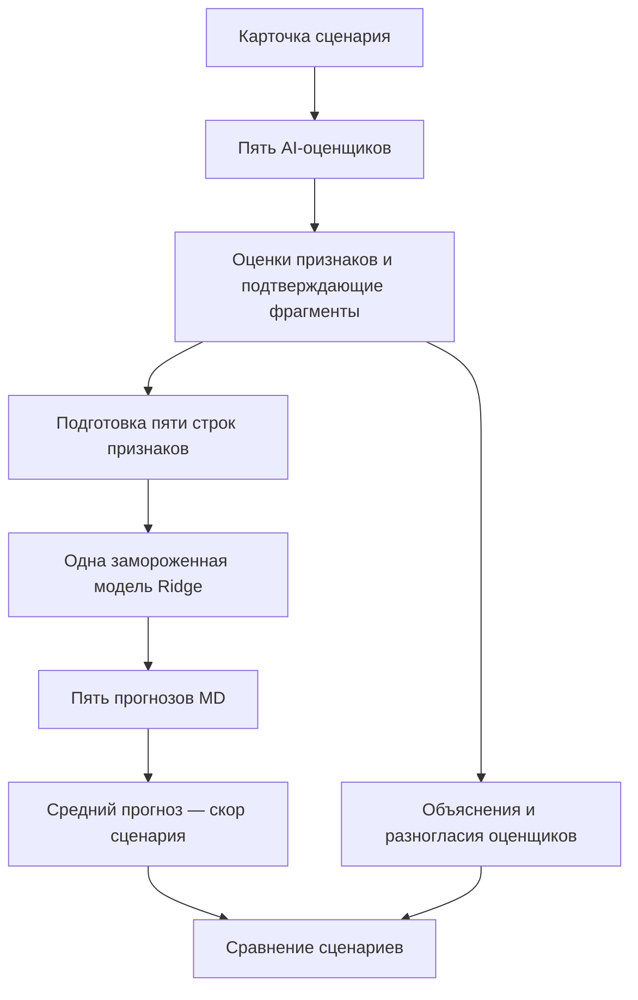

# AIPM 3.1 · Оценка рекламных сценариев

Модель прогнозирует, насколько легко зрителю будет понять идею будущей рекламы: что предлагает компания и какую пользу получает пользователь. Она помогает сравнивать сценарии до производства ролика и находить особенности текста, влияющие на прогноз считываемости — **Message Delivery (MD)**.

Пользователь загружает карточки сценариев. Пять AI-оценщиков читают их по заданным правилам, оценивают признаки и поясняют решения фрагментами текста. Отдельная обученная модель Ridge переводит эти признаки в итоговый скор каждого сценария.

**Статус репозитория:** описание выбранной исследовательской модели. Код приложения, промпты и обученные артефакты ещё предстоит перенести. Сам по себе этот README не запускает оценку сценариев.

## Что оценивает модель

Оценивается считываемость предложения по описанному содержанию рекламы. Заметность, запоминаемость и общий индекс AIPM3 не рассчитываются: эти компоненты требуют информации об исполнении готового ролика.

Скор — прогноз модели на шкале человеческого MD. Это не результат опроса зрителей и не гарантия того, как будет воспринят будущий ролик после съёмки и монтажа.

## Как устроена оценка



1. Карточка сохраняет тайминги, описание изображения, реплики с указанием говорящих и экранный текст. Голос и музыка, звуковой дизайн и креативные приёмы передаются как дополнительный контекст.
2. Каждый AI-оценщик самостоятельно применяет один и тот же протокол. Он не получает ответы других оценщиков, человеческие MD, видеоскоры или классы видео.
3. Программа проверяет структуру ответов и подготавливает семь входов модели. Для количества выгод действует отдельная процедура группировки, описанная ниже.
4. Одна и та же обученная Ridge рассчитывает прогноз для каждой из пяти строк. Среднее **пяти прогнозов** становится скором сценария.
5. Пользователь получает скор, класс, оценки признаков и основания для них. Разногласия оценщиков помогают находить неоднозначные места карточки.

AI-оценщик здесь — языковая модель, измеряющая признаки по инструкции. Он не изображает группу зрителей. Итоговый MD рассчитывает Ridge, а не сама языковая модель.

## Семь признаков выбранной модели

| Признак | Что проверяется | Значение до агрегации |
|---|---|---|
| **Главный персонаж** | Есть ли один конкретный персонаж, который явно выделен описанными сценами и остаётся центром истории? | 0 или 1 |
| **Числовое предложение** | Прописан ли на экране числовой оффер: скидка, цена, дата-дедлайн либо предложение «бесплатно» с указанием предмета? | 0 или 1 |
| **Количество выгод** | Сколько самостоятельных преимуществ пользователь явно получает из предложения? | 0–4 |
| **Необходимость объяснения новизны** | Насколько непривычны продукт, функция или условия и сколько объяснения требует их понимание? | 0–3 |
| **Промо** | Есть ли специальный стимул к покупке: акция, скидка, бонус, промокод, распродажа или явно обозначенное временное ограничение предложения? | 0 или 1 |
| **Точность содержания** | Насколько содержательно определено, что именно утверждается о сервисе: от общего обещания до функции с конкретными уточнениями и условиями? | 0–4 |
| **Конкуренция посылов** | Сколько дополнительных самостоятельных целей или обещанных результатов предлагается запомнить помимо основного посыла? | Число дополнительных посылов, без верхнего ограничения |

Правила, важные для интерпретации:

- **Главный персонаж:** слова «герой» или «он» сами по себе не доказывают его единство и выделение. При недостаточном описании значение консервативно кодируется как 0 со статусом `insufficient_description`; это отличается от подтверждённого отсутствия центрального персонажа.
- **Числовое предложение:** число только в речи не засчитывается. Экранная надпись может быть указана в отдельном поле или явно описана внутри сцены.
- **Новизна:** измеряется непривычность предложения, а не оригинальность сюжета или длина объяснения автора.
- **Промо:** обычная цена, общая польза сервиса и призыв покупать сами по себе не считаются промо.
- **Конкуренция:** повторения, шаги одной цели, примеры и условия одного предложения не становятся отдельными посылами. Сырой показатель каждого оценщика: `max(число самостоятельных сообщений − 1, 0)`.

Точные промпты и JSON-схемы являются частью протокола. Краткие определения в таблице не заменяют их при воспроизведении расчёта.

### Как считается количество выгод

1. Оценщик выделяет кандидатов в выгоды и приводит точные цитаты из описания изображения, речи или экранного текста.
2. Повторы и пояснения одной выгоды объединяются в группы. Каждая группа должна описывать самостоятельное преимущество пользователя.
3. У кандидата сохраняются номер группы и обоснование. Значение `group_id = 0` означает, что кандидат исключён из счёта; причина обязательна.
4. Программа вычисляет `min(4, число групп)`. Неограниченное число групп также сохраняется для аудита.

Например, «скидки на одежду и электронику — покупки выгоднее» — одна выгода. Доставка и возможность проверить заказ до подтверждения оплаты — две самостоятельные выгоды. «Проверьте заказ» и «оплатите после проверки» внутри одной механики не считаются двумя выгодами.

Авторское объяснение в разделе креативных приёмов не создаёт выгоду без подтверждения в сценах. Обоснование требуется и при нуле выгод.

### Что означает точность содержания

| Балл | Содержание утверждения |
|---|---|
| 0 | Нет утверждения о продукте или возможности: только бренд, настроение или призыв без обещания. |
| 1 | Есть общее оценочное обещание, например «удобно» или «выгодно», без раскрытой практической функции. |
| 2 | Названа функция или категория: купить мебель, найти работу, забронировать жильё. |
| 3 | Функция сужена конкретной задачей, подкатегорией объекта, способом услуги или областью применения. |
| 4 | Дополнительно дана ещё одна самостоятельная подробность того же предложения: например, условие доступности или способ оплаты. |

Одно уточнение нельзя засчитать дважды. Подробность описания сама по себе не повышает оценку. Это **точность содержания 0–4**, выбранная для сценарной модели; её нельзя подменять другой шкалой конкретности.

## Пять AI-оценщиков

| Оценщик | Идентификатор модели в сохранённом протоколе |
|---|---|
| Gemini 3.1 Pro | `google/gemini-3.1-pro-preview` |
| Claude Sonnet 4.6 | `anthropic/claude-sonnet-4.6` |
| GPT-5.4 | `openai/gpt-5.4` |
| Grok 4.6 | `x-ai/grok-4.6` |
| Claude Opus 4.6 | `anthropic/claude-opus-4.6` |

Это пять разных моделей, а не пять запусков одной модели. Их оценки самостоятельны, но не гарантированно статистически независимы: ошибки языковых моделей могут совпадать.

Выбранный протокол складывается из общей оценки признаков, отдельной оценки точности содержания и отдельной группировки выгод. Исторические ответы общей стадии могут содержать дополнительные поля; в Ridge поступают только семь выбранных признаков, а старое прямое число выгод заменяется результатом группировки. Объединение стадий в новый промпт требует отдельной проверки.

У **конкуренции посылов** сначала берётся среднее пяти сырых значений и записывается во все пять строк. Остальные шесть входов остаются индивидуальными. Затем рассчитываются пять прогнозов Ridge и их среднее. Прогноз по одному усреднённому вектору всех признаков не заменяет эту процедуру.

## Что подаётся на вход

Для новой карточки требуется привести данные к тому же JSON-контракту, что использовался в исследовании:

| Поле | Содержание |
|---|---|
| `id` | Уникальный идентификатор сценария. |
| `duration_sec` | Планируемая длительность в секундах. |
| `fixed_main_claim` | Зафиксированная формулировка основного посыла. |
| `scenes[].time` | Интервал сцены. |
| `scenes[].visual` | Персонажи, действия и описанное изображение. |
| `scenes[].speech` | Дословные реплики с обозначениями персонажей и ГЗК. |
| `scenes[].screen_text` | Текст, который должен появиться на экране. |
| `voice_and_music` | Описание голоса и музыки. |
| `sound_design` | Звуковые элементы и их роль. |
| `creative_techniques` | Описание креативных приёмов. |

В выбранной версии `fixed_main_claim` доступен оценщикам. Поэтому текущую процедуру нельзя описывать как слепое восстановление главной идеи без подсказки. Для новой карточки источник этой формулировки нужно определить и сохранить до оценки; удаление поля или изменение способа его получения меняет протокол.

Голос, музыка, звуковой дизайн и креативные приёмы — **контекст**, а не дополнительные входы Ridge. Авторские пояснения не дают права выдумывать отсутствующие действия, реплики или надписи.

При подготовке карточки нужно сохранять смысл, тайминги, говорящих, речь и экранный текст. Если редактируется один раздел, остальные разделы не удаляются и не переписываются. Неоднозначность описания фиксируется, а не достраивается по знанию готового видео.

## Как обучена и применяется Ridge

Ridge обучена на признаках сценариев с целевой величиной **человеческий MD соответствующих готовых роликов**. Видеоскоры используются для проверки согласованности, а не как целевая переменная обучения этой модели.

- Семь входов, `alpha = 1`, логарифмическое преобразование целевого MD.
- Заполнение пропусков и стандартизация определяются по обучающей части.
- Веса строк нормируются по семействам: пять оценок не превращают один сценарий в пять независимых объектов.
- Обратное преобразование из log-MD, затем линейная калибровка, рассчитанная на обучающей части.
- Для нового сценария используются сохранённые параметры и коэффициенты. Обучение при каждой загрузке не требуется.

Условно расчёт одной строки выглядит так:

```text
признаки → сохранённая подготовка → Ridge в log-MD
         → обратное преобразование → калибровка → прогноз MD

скор сценария = среднее пяти прогнозов MD
```

Коэффициенты нельзя переносить из видеомодели или смешивать с другой версией измерения признаков. Знак коэффициента описывает связь в обученной комбинации признаков, а не причинное правило «добавление этого приёма улучшит рекламу».

## Результаты выбранной модели

Проверка выполнена на **58 сценариях из 56 семейств**. Все корреляции в таблице — **Спирмен по OOF-прогнозам**.

| Показатель | Результат |
|---|---:|
| Корреляция с сохранёнными видеоскорами MD | **0,764** |
| Корреляция с человеческим MD | **0,524** |
| Средняя абсолютная ошибка относительно человеческого MD | **5,733 п.п.** |
| Корреляция классов сценария с классами видео | **0,668** |

**OOF (out-of-fold)** означает, что каждый проверяемый сценарий оценивался моделью, не обучавшейся на нём и других материалах его семейства. Использовалось 56 исключений семейств, а не независимое исключение каждой строки AI-ответа. Подготовка признаков и калибровка обучались внутри соответствующего исключения.

После оценки качества отдельная полная модель обучена на всех доступных сценариях для дальнейшего применения. Её прогнозы на обучающем наборе (`full_fit`) не используются как показатели качества.

### Классы

| Класс | Скор MD на шкале 0–100 |
|---|---|
| Низкий | ≤ 20 |
| Средний | > 20 и ≤ 26 |
| Высокий | > 26 |

Пороговые значения зафиксированы. Корреляция 0,764 не означает точность 76,4%: совпадение классов измеряется отдельно.

### Ограничения

- Внешней независимой проверки пока нет. Эти 58 сценариев использовались в исследованиях признаков и выборе состава оценщиков, поэтому OOF не устраняет риск подбора решений под набор данных.
- Состав пяти оценщиков выбран при сравнении 128 комбинаций на том же наборе. Это исследовательский выбор, а не доказанный универсальный оптимум.
- Модель выявляет только 4 из 13 низких по видеомодели роликов. Её пока недостаточно для надёжного автоматического отсева всех слабых сценариев.
- Высокая корреляция с видео не гарантирует совпадение отдельных оценок. Сценарий не описывает всех особенностей будущего исполнения.
- Совпадение оценщиков не доказывает правильность. Разброс пяти прогнозов показывает чувствительность к измерению признаков, а не доверительный интервал человеческого MD.
- Новые AI-запросы могут давать другие ответы даже при тех же настройках. Точное воспроизведение обеспечивается сохранёнными входами, ответами, протоколами и моделью.


## Что уже сохранено в исследовательском проекте

Артефакты существуют в отдельной рабочей папке исследования; **в этот репозиторий они пока не перенесены**.

| Путь от корня исследовательской рабочей папки | Назначение |
|---|---|
| `outputs/scenario_active_selection.json` | Реестр выбранной модели. |
| `outputs/scenario_selected_five_benefit_groups_20261102/selection.json` | Состав модели, оценщики, ссылки на артефакты и показатели. |
| `outputs/scenario_selected_five_benefit_groups_20261102/benefit_counting_protocol.json` | Точная инструкция и схема группировки выгод. |
| `outputs/scenario_selected_five_benefit_groups_20261102/features_repeats_290.csv` | Пять подготовленных строк на каждый из 58 сценариев. |
| `outputs/scenario_selected_five_benefit_groups_20261102/individual_features_290.csv` | Индивидуальные значения до усреднения конкуренции. |
| `outputs/scenario_selected_five_benefit_groups_20261102/comparison_58.csv` | Сохранённые OOF-прогнозы и значения для сравнения. |
| `outputs/scenario_selected_five_benefit_groups_20261102/fold_plan_56.json` | Зафиксированные исключения семейств. |
| `outputs/scenario_selected_five_benefit_groups_20261102/replay.py` | Проверка сохранённого расчёта без API и переобучения. |
| `outputs/scenario_selected_five_benefit_groups_20261102/manifest.json` | Контрольные суммы файлов. |
| `outputs/scenario_benefit_groups_five_v3_20261102/models/benefit_groups/ridge/` | Обученные коэффициенты и состояние Ridge. |

Проверка из корня **существующей исследовательской рабочей папки**, а не из этого пустого репозитория:

```bash
python3 -B outputs/scenario_selected_five_benefit_groups_20261102/replay.py
```

Команда проверяет контрольные суммы, воспроизводит прогнозы полной модели и проверяет сохранённые OOF-показатели. Она не отправляет тексты в API и не обучает модель заново. Текущие артефакты содержат ссылки на исследовательскую папку; перенос в самостоятельный репозиторий требует адаптации путей и повторной проверки совпадения результатов.

## Следующие шаги для запуска приложения

1. Перенести выбранную модель, точные промпты всех стадий и необходимые проверки в самостоятельный пакет с относительными путями. Не собирать новую модель из разрозненных экспериментальных файлов.
2. Проверить воспроизведение сохранённых оценок после переноса. Коэффициенты, входы и порядок агрегации должны остаться прежними.
3. Добавить загрузку JSON-карточек и проверку обязательных полей. Импорт DOCX реализовать отдельно с сохранением содержания и структуры карточки.
4. Подключить пять оценщиков. Настройки и API-ключ хранить вне Git; сохранять запросы, ответы, версии протокола и хеши входов. Новые обращения к API запускать явно, повторный расчёт — из сохранённых ответов.
5. Добавить интерфейс сравнения: скор, класс, семь признаков, подтверждающие фрагменты и разногласия оценщиков. Объяснения связывать с фактическими входами модели; числовые вклады рассчитывать отдельно, а не придумывать по знаку коэффициента.
6. Проверить модель на новых сценариях с парными видео и человеческим MD, которые не использовались при выборе признаков и оценщиков.

Возможная структура **после реализации**:

```text
AIPM-3.1_scenarios/
├── README.md
├── app.py                  # интерфейс
├── scenario_model/         # загрузка, извлечение и расчёт
├── protocols/              # точные промпты и JSON-схемы
├── artifacts/              # выбранная модель и manifest
├── examples/               # разрешённые примеры карточек
└── tests/                  # воспроизведение и проверки контракта
```

Эта структура — план переноса, а не перечень уже реализованных файлов. Закрытые сценарии, исходные ответы с их текстами и исследовательские таблицы не следует переносить в публичный репозиторий автоматически.

## Связь с AIPM3

При подготовке документации изучен [AIPM3_Streamlit](https://github.com/Korneevs/AIPM3_Streamlit): разделение извлечения признаков и расчёта, загрузка замороженных моделей, проверка контрольных сумм, сохранение результатов и объяснения для менеджеров.

Для сценарного проекта используется тот же организационный принцип: **описание → измерение признаков → обученная модель → объяснимый результат**. При этом состав признаков, оценщики и коэффициенты берутся из выбранной сценарной модели. Видео-панели, формула произведения заметности, считываемости и запоминаемости, ручные надбавки и нормы интерфейса не переносятся в неё автоматически.
